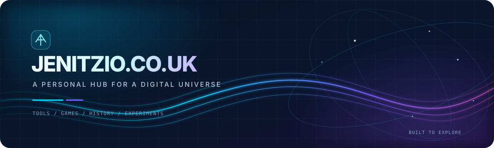

  

  
  
  

  <strong>A personal hub orbiting many worlds — tools, history, games, and experiments.</strong> 
  One starting point for a growing collection of web projects, creative experiments, and useful destinations.

  <a href="#the-idea">The idea</a> &nbsp;·&nbsp;
  <a href="#inside-the-hub">Inside the hub</a> &nbsp;·&nbsp;
  <a href="#explore-the-ecosystem">Explore</a> &nbsp;·&nbsp;
  <a href="#run-it-locally">Run locally</a> &nbsp;·&nbsp;
  <a href="#technology">Technology</a>

---

## The idea

**Jenitzio.co.uk is the front door to a digital playground.** Instead of treating every website, game, utility, and experiment as an isolated destination, the hub brings them together in one visual place.

The experience has a distinctive **neo-ocean aesthetic**: deep navy surfaces, luminous cyan and violet accents, layered motion, and glass-like panels. The interface is designed to feel exploratory without losing the practicality of a launchpad.

This repository contains the hub's main front-end page. Some destinations opened by the hub are separate applications or external services; they are not all implemented in this repository.

## Inside the hub

<table>
  <tr>
    <td width="50%" valign="top">
      <h3>01 / A portal directory</h3>
      A central index for projects spanning AI, learning, history, media, utilities, and experimental web applications. Open a destination without having to remember every address.
    </td>
    <td width="50%" valign="top">
      <h3>02 / A game-discovery hub</h3>
      A collection of browser games and interactive projects, from arcade-style experiences to first-person and voxel worlds.
    </td>
  </tr>
  <tr>
    <td width="50%" valign="top">
      <h3>03 / An AI side panel</h3>
      A built-in helper for quick questions, ideas, and playful prompts. Its responses use an external Pollinations service rather than a model bundled in this repository.
    </td>
    <td width="50%" valign="top">
      <h3>04 / Community features</h3>
      The public source intentionally has no account, profile, direct-message, or community-chat backend connection. Those features are disabled here so this repository does not call your private server.
    </td>
  </tr>
  <tr>
    <td width="50%" valign="top">
      <h3>05 / Personal touches</h3>
      Accent palettes, favorites, and local preferences help make the interface feel like your own. Browser-side preferences are stored locally.
    </td>
    <td width="50%" valign="top">
      <h3>06 / A motion-rich interface</h3>
      A layered ocean-inspired backdrop, atmospheric lighting, responsive layouts, and performance-aware effects give the hub its visual identity.
    </td>
  </tr>
</table>

## Explore the ecosystem

Here is a selection of destinations linked from the hub. This is an evolving collection rather than a promise that every project is built into this repository.

### AI, labs, and experiments

- [JenAI](https://jenitzio.co.uk/jenAI) — AI-focused experiments
- [VolunteerAI](https://jenitzio.co.uk/volunteer-ai) — a separate AI project
- [AetherLink](https://jenitzio.co.uk/aetherlink) — an experimental portal
- [Offline AI](https://brain.jenitzio.co.uk) — a local/offline-AI-themed destination
- [AI Hub](https://nexusbrain.jenitzio.co.uk) — an AI project directory
- [StudioAI](https://jenitzio.co.uk/AIstudio) — creative AI experiments
- [SpaceSim](https://space.jenitzio.co.uk) — a space-themed project

### Games and interactive worlds

- [Krnk.io](https://krnkio.jenitzio.co.uk)
- [Skyhook Arena](https://jenitzio.co.uk/skyhook)
- [Voxel](https://voxel.jenitzio.co.uk)
- [NeonBlasters](https://jenitzio.co.uk/neonblasters/)
- [BlackHole.io](https://jenitzio.co.uk/blackhole)
- [HexGL](https://jenitzio.co.uk/HexGL)
- [Quake 5](https://jenitzio.co.uk/quake5)
- [SectorFPS](https://jenitzio.co.uk/SectorFPS)
- [Wordle / Globle](https://jenitzio.co.uk/Wordle)
- [Arcade Games](https://jenitzio.co.uk/arcade)

### History, learning, and media

- [HistoryPedia](https://historypedia.jenitzio.co.uk)
- [Martin Luther](https://martinluther.jenitzio.co.uk)
- [Jenitzio Archive](https://jenitzio.co.uk/archive)
- [Video](https://jenitzio.co.uk/video)
- [Sonate Music](https://jenitzio.co.uk/music)
- [NeoGeo](https://jenitzio.co.uk/NeoGeo)

### Productivity and community

- [NeoHub](https://neohub.base44.app) — a separate productivity suite presenting documents, slides, forms, and spreadsheets
- [Nexus Chat](https://chat.jenitzio.co.uk) — chat, rooms, and community features

**Start exploring:** [jenitzio.co.uk](https://jenitzio.co.uk)

> External destinations can change independently of this repository. They may have their own hosting, technology, availability, and licensing.

## Run it locally

The main front-end entry point is <code>jenitzio.html</code>. To view it from a local web server:

~~~bash
git clone https://github.com/jenitzio/Jenitzio.co.uk.git
cd Jenitzio.co.uk
python3 -m http.server 8000
~~~

Then open:

**http://localhost:8000/jenitzio.html**

You can also open <code>jenitzio.html</code> directly in a browser for a quick static inspection. In this public source version, account, profile, direct-message, and community-chat backend integration is intentionally disabled. The optional AI helper uses the external Pollinations service. This repository does not configure, deploy, or administer your private server.

## Technology

| Area | Implementation |
| --- | --- |
| Main entry point | <code>jenitzio.html</code> |
| Front end | HTML, CSS, and JavaScript |
| Styling | Inline styles and custom CSS within the main HTML page |
| Personalization | Browser-side storage for preferences and favorites |
| AI helper | External Pollinations text-generation service |
| Accounts and community chat | Backend integration deliberately disabled in this public source build |
| Typography and external content | External web resources, including Google Fonts |

The current repository intentionally keeps its main hub page concentrated in one HTML entry point. The linked projects and services may use different stacks and are maintained separately.

## Backend separation

This public repository contains no private backend host address or API route calls. Account, profile, direct-message, and community-chat integration is disabled in this copy; the browser's Content Security Policy only permits connections to the external text service used by the optional AI helper.

**This separates the public frontend source from the private backend; it does not by itself secure a running server.** Server binding, firewall rules, reverse-proxy routes, authentication, and deployment hooks must be checked on the server independently.

## Repository structure

~~~text
Jenitzio.co.uk/
├── assets/
│   └── readme-banner.svg
├── jenitzio.html
├── LICENSE
└── README.md
~~~

## Contributing

Ideas, bug reports, and focused improvements are welcome. Before proposing a change, check whether the relevant behavior belongs to this hub page or to a separately hosted project.

For substantial changes, opening an [issue](https://github.com/jenitzio/Jenitzio.co.uk/issues) first can help establish the intended behavior. Pull requests should describe what changed and how it was tested.

## License

This repository is licensed under the **Apache License 2.0**. See [LICENSE](LICENSE) for the complete terms.

The license in this repository does not automatically apply to external websites, third-party services, or separately hosted projects linked from the hub; check their respective terms where relevant.

---

  <strong>Created by <a href="https://github.com/jenitzio">@jenitzio</a></strong> 
  A growing collection of things to explore, build, and play with.

